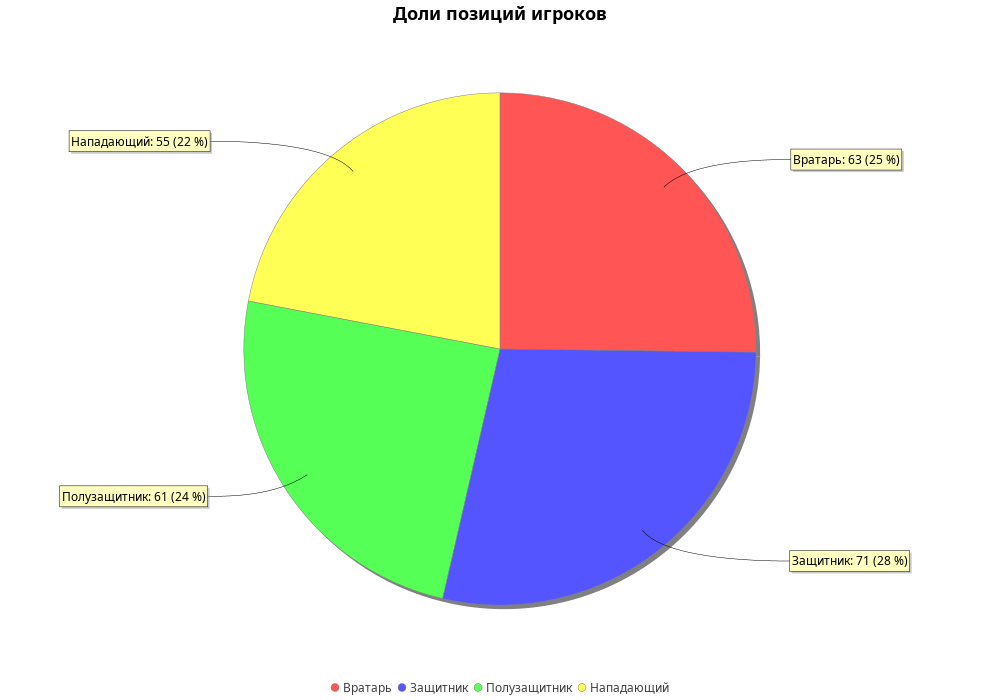
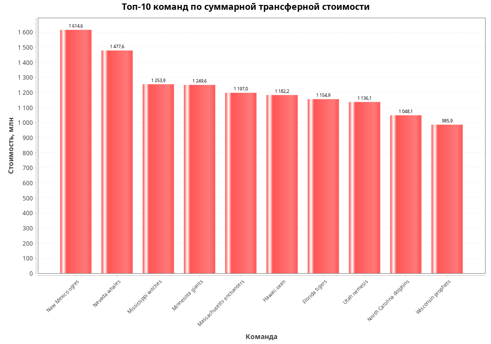
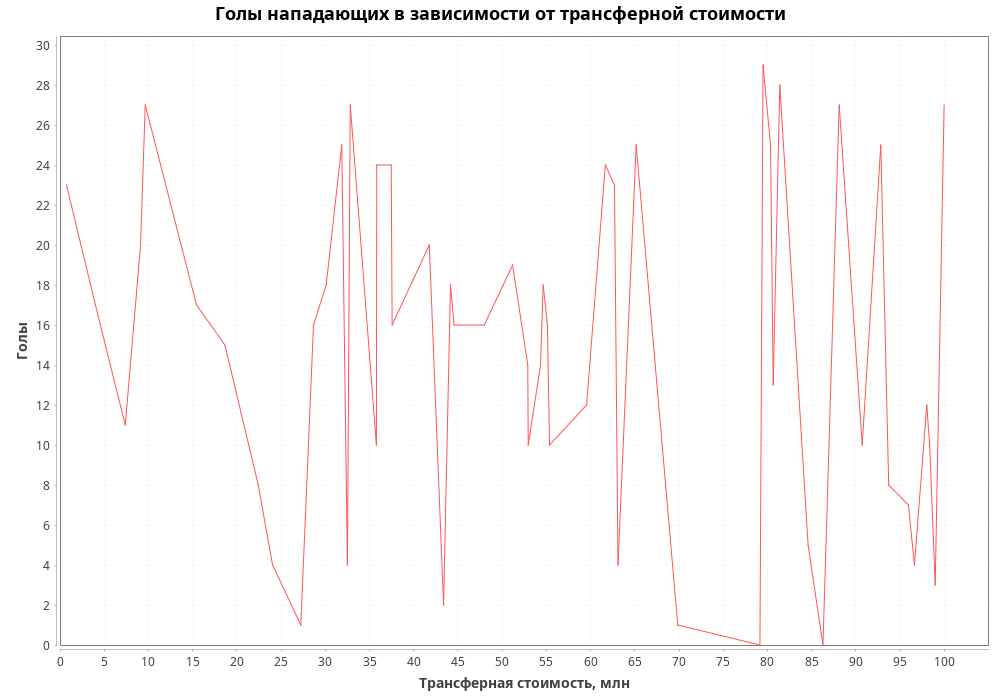
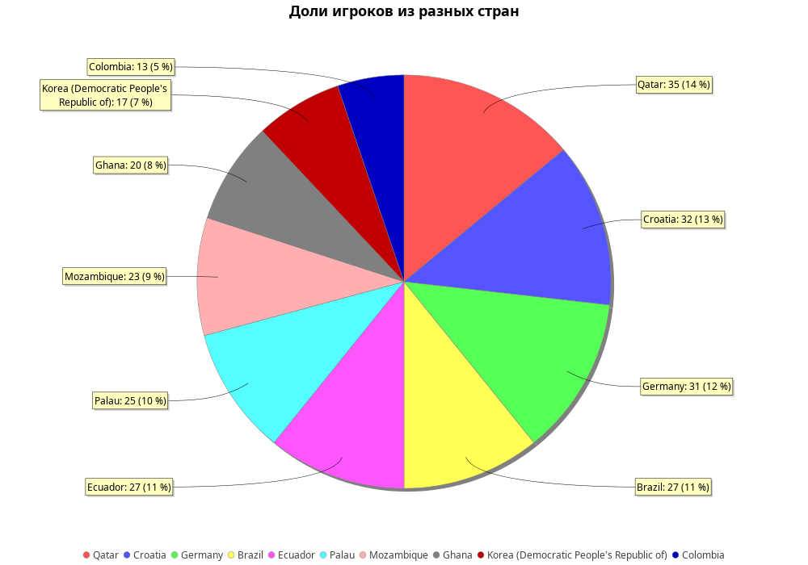

# Тема 10. Stream API, функциональные интерфейсы

Упражнение «Чемпионат»: чтение `fakePlayers.csv`, запросы к данным через Stream API
и визуализация результатов с помощью JFreeChart.

## Что сделано

- `Player` — класс данных игрока;
- `Position` — позиция на поле с русским названием;
- `CsvPlayersReader` — чтение CSV с разделителем `;` (UTF-8, поддержка кавычек);
- `IResolver` и `PlayerResolver` — все 8 запросов задания через Stream API;
- `ChartService` — четыре варианта графиков (сохраняются в `charts/`);
- `ChartViewer` — окно с вкладками для просмотра графиков;
- `Main` — вывод ответов и запуск визуализации.

## Результаты по файлу `fakePlayers.csv`

Загружено 250 игроков.

| № | Запрос | Результат |
|---|--------|-----------|
| 1 | Игроков без агентства | **26** |
| 2 | Максимум голов защитника | **29** |
| 3 | Позиция самого дорогого немецкого игрока | **Нападающий** |
| 4 | Игроки по позициям | Вратарь — 63, Защитник — 71, Полузащитник — 61, Нападающий — 55 |
| 5 | Команды чемпионата | **10** команд |
| 6 | Топ-5 команд по голам | New Mexico ogres — 501, Wisconsin prophets — 481, Nevada whales — 465, Utah nemesis — 365, Hawaii oxen — 352 |
| 7 | Агентство с минимальной суммой игроков | **Schaden, Robel and Raynor** |
| 8 | Самая грубая команда | **Wisconsin prophets** (в среднем 5,46 удаления на игрока) |

Пункт 7 реализован как агентство с минимальной **суммарной трансферной стоимостью**
игроков. Игроки без агентства при расчёте не учитываются.

## Задание 2. Графики

Реализованы все четыре варианта. Без аргументов программа строит все графики
и открывает окно с вкладками; PNG-файлы всегда сохраняются в `charts/`.

### Вариант 1. Доли позиций игроков



### Вариант 2. Топ-10 команд по суммарной трансферной стоимости



### Вариант 3. Голы нападающих в зависимости от трансферной стоимости



### Вариант 4. Доли игроков из разных стран



## Запуск

### IntelliJ IDEA

Открыть папку `tema10` как проект (или импортировать `pom.xml`), запустить
`championship.Main`. Рабочая директория — корень `tema10`, чтобы нашёлся
`data/fakePlayers.csv`.

### Скрипт

```bash
cd tema10
./run.sh
```

Скрипт сам ищет JDK (в `PATH`, `JAVA_HOME` или `~/.jdks`), компилирует проект
и запускает программу.

### Maven

```bash
cd tema10
mvn compile exec:java
```

## Параметры запуска

```bash
# номер в списке: вариант = N % 4 + 1
./run.sh --number=7

# конкретный вариант графика (1–4)
./run.sh --variant=2

# только сохранить PNG, без окна
./run.sh --no-gui

# свой CSV-файл
./run.sh path/to/fakePlayers.csv --variant=4
```

Если `--number` и `--variant` не указаны, строятся все четыре графика.
